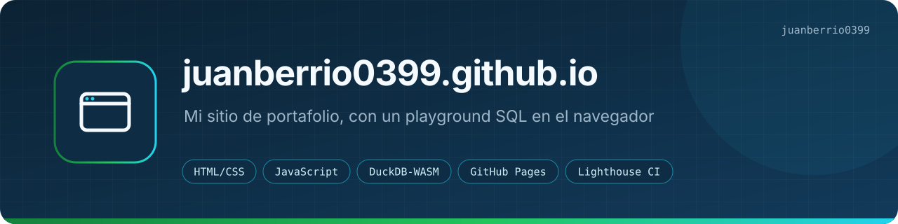
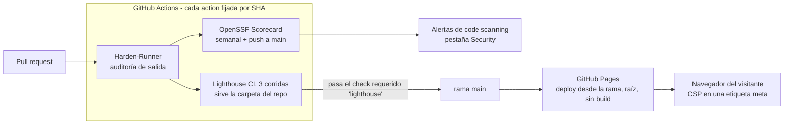
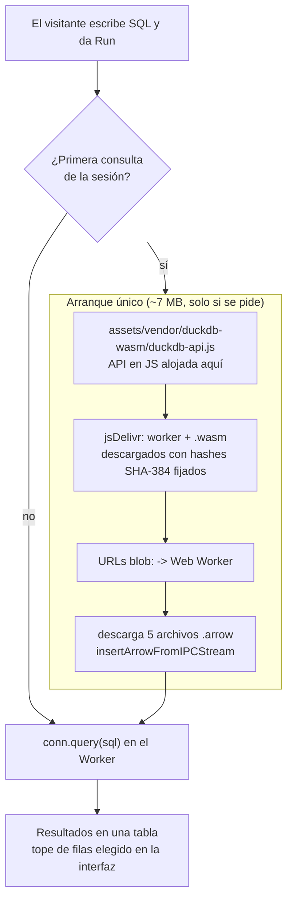

<p align="center"></p>
<p align="center"><a href="README.md">English</a> · <b>Español</b></p>
<b>Qué hace:</b> es el código de <a href="https://juanberrio0399.github.io">juanberrio0399.github.io</a>, mi portafolio como Cloud &amp; Data Engineer: perfil, proyectos, hoja de vida en ES/EN, el caso de estudio de DataForge y un playground de SQL.<br>
<b>Cómo funciona:</b> HTML, CSS y JavaScript sin paso de build. GitHub Pages publica <code>main</code> tal cual, y el playground corre DuckDB-WASM en tu navegador sobre un snapshot pequeño de mi actividad pública en GitHub.<br>
<a href="https://github.com/juanberrio0399/juanberrio0399.github.io/actions/workflows/lighthouse.yml"></a> <a href="https://scorecard.dev/viewer/?uri=github.com/juanberrio0399/juanberrio0399.github.io"></a> <a href="LICENSE"></a>

---

## Por qué existe

Casi todo mi trabajo corre sobre datos privados de una empresa, así que un reclutador no puede simplemente abrir los repos. El sitio tiene dos trabajos. Primero, responderle a un reclutador en una sola página: selector ES/EN, pestañas por proyecto, hoja de vida descargable y una hoja de estilos de impresión, de modo que "Descargar portafolio (PDF)" es solo `window.print()` y no hay un PDF aparte que mantener al día. Segundo, mostrar el trabajo en vez de describirlo: [`playground.html`](playground.html) corre SQL de verdad en el navegador del visitante con el mismo patrón local-first que uso en los tableros de DataForge, en un tamaño que se lee de una sentada.

## Cómo funciona

### Sitio y publicación



Pages publica desde la rama (`main`, `/`), así que mergear es desplegar. `.nojekyll` apaga Jekyll; si no, se saltaría cualquier ruta que empiece por guion bajo y agregaría un paso de build que no hace falta.

Pages no puede enviar headers de respuesta, entonces la Content-Security-Policy va en una etiqueta `<meta http-equiv>` en cada página. La política base es `default-src 'none'` más los pocos hosts que el sitio usa de verdad (Google Fonts). `playground.html` tiene su propia política, más amplia, porque WebAssembly la necesita.

### Playground



El motor no carga con la página. Los 7 MB se descargan con el primer `Run`, así que quien nunca corre una consulta solo paga por una página HTML normal. El worker y el `.wasm` vienen de jsDelivr, pero se piden con `fetch(..., { integrity })` contra hashes SHA-384 fijados en [`assets/js/playground.js`](assets/js/playground.js) y arrancan desde URLs `blob:`. Si el CDN llegara a servir un archivo distinto, no carga en vez de ejecutarse. Las extensiones conocidas de DuckDB están apagadas (`autoinstall_known_extensions = false`), así que una consulta no puede traer código de un tercer host.

Los datos son cinco archivos Apache Arrow IPC, unos 28 KB en total: 7 repos, 12 filas de lenguajes, 77 días con commits, 154 pull requests y 1 fila de snapshot tomada el 2026-09-15. Usé Arrow y no Parquet porque DuckDB-WASM lee Arrow de forma nativa; con Parquet el navegador tendría que bajar la extensión de parquet en tiempo de ejecución.

Los diagramas de los proyectos que describe el sitio (DataForge y el Serverless RAG Assistant) están en [docs/project-architecture.md](docs/project-architecture.md) (en inglés).

## Con qué se conecta

| Repo o sistema | Cómo |
|---|---|
| [juanberrio0399](https://github.com/juanberrio0399/juanberrio0399) | El README de mi perfil de GitHub enlaza aquí como portafolio principal |
| [serverless-rag-assistant](https://github.com/juanberrio0399/serverless-rag-assistant) | Tarjeta de proyecto con enlace al repo y a la demo en vivo |
| [dockerized-data-tool](https://github.com/juanberrio0399/dockerized-data-tool) | Tarjeta de proyecto con enlace al repo |
| DataForge y DataForge Cloud (privados) | Se describen en `case-study-dataforge.html`, anonimizados. Esa página es ahora la fuente; antes vivía en un repo privado |
| API REST de GitHub | `scripts/playground/build_data.py` lee mi actividad pública para reconstruir el snapshot del playground. El sitio nunca la llama en tiempo de ejecución |

## Cómo correrlo

Sirve cualquier servidor de archivos estáticos. Las páginas usan rutas relativas (menos `404.html`, a propósito).

```sh
python -m http.server 8000
# http://localhost:8000/  ·  /playground.html  ·  /case-study-dataforge.html
```

Abrir los archivos con `file://` no funciona: `playground.js` es un módulo ES y los Arrow se piden al mismo origen.

Actualizar el snapshot del playground (escribe en `assets/data/playground/`):

```sh
pip install duckdb pyarrow
GITHUB_TOKEN=$(gh auth token) python scripts/playground/build_data.py
```

El token es opcional, solo sube el límite de la API de GitHub. Una corrida toma unos minutos e imprime cuántas filas quedó cada tabla.

Volver a generar la API de DuckDB-WASM cuando se sube la versión del motor (necesita `npm` y `openssl`):

```sh
sh scripts/playground/vendor_duckdb.sh
```

Reescribe `assets/vendor/duckdb-wasm/duckdb-api.js` e imprime las cuatro líneas SHA-384 que van en el mapa `SRI` de `assets/js/playground.js`. `ENGINE_VERSION` y las versiones de `THIRD_PARTY_NOTICES.txt` tienen que cambiar en el mismo commit.

No hay comando local para la compuerta de calidad. `npx @lhci/cli autorun` sí corre las auditorías en Windows, pero chrome-launcher no logra borrar su carpeta temporal (`EPERM`) y termina con error de todos modos; los números que cuentan son los del job de Lighthouse en el PR, cuyo log enlaza el reporte HTML completo.

## Estructura

| Ruta | Qué hay |
|---|---|
| `index.html` | El portafolio: perfil, habilidades, pestañas de proyectos, contacto. JSON-LD y la CSP de la página |
| `case-study-dataforge.html` | Caso de estudio y detalle técnico de DataForge, ES/EN, con `assets/css/case-study.css` y `assets/js/case-study.js` |
| `playground.html` | El playground de SQL: consultas de ejemplo, editor, esquemas de tablas y su propia CSP |
| `404.html` | Lo sirve Pages para cualquier ruta desconocida; por eso usa rutas absolutas desde la raíz |
| `assets/js/main.js` | Selector de idioma, pestañas, animación al hacer scroll, impresión. Sin handlers inline, así la CSP no necesita `'unsafe-inline'` |
| `assets/js/playground.js` | Arranque del motor, hashes SRI, consultas de ejemplo, mensajes ES/EN, tabla de resultados |
| `assets/css/` | `main.css` (sitio + impresión), `case-study.css`, `playground.css`, `404.css` |
| `assets/cv/` | Las hojas de vida descargables, ES y EN (PDF) |
| `assets/vendor/duckdb-wasm/` | API en JS de DuckDB-WASM (~215 KB, la genera el script de vendor) y sus avisos de terceros |
| `assets/data/playground/*.arrow` | El snapshot versionado que consulta el playground |
| `scripts/playground/` | `build_data.py` (reconstruye los Arrow) y `vendor_duckdb.sh` (reconstruye la API e imprime los hashes) |
| `docs/` | Diagramas de los proyectos, decisiones y operación, banners |
| `.github/workflows/` | `lighthouse.yml` (compuerta de calidad en cada PR) y `scorecard.yml` (puntaje de cadena de suministro) |
| `.github/dependabot.yml` | Actualización semanal agrupada de los SHA de las actions |
| `.lighthouserc.json` | Qué páginas audita Lighthouse (inicio, playground, caso de estudio) y los umbrales |
| `SECURITY.md` | Alcance y cómo reportar una vulnerabilidad |
| `robots.txt`, `sitemap.xml`, `og-image.png`, `favicon.svg`, `.nojekyll` | Indexación, vista previa en redes y la desactivación de Jekyll |

Por qué no hay framework, por qué la CSP va en una etiqueta meta, qué corre solo y qué hacer cuando Lighthouse se pone en rojo: [docs/operation.es.md](docs/operation.es.md).

## Estado

En vivo en <https://juanberrio0399.github.io>. Funcionan las cuatro páginas, el playground de punta a punta, los dos workflows de CI, Dependabot y la política de seguridad. El snapshot del playground todavía se actualiza a mano (issue [#42](https://github.com/juanberrio0399/juanberrio0399.github.io/issues/42)). Dónde está y qué sigue: [PLAN.md](PLAN.md) (en inglés).

## Licencia

[MIT](LICENSE) · Juan Berrio
