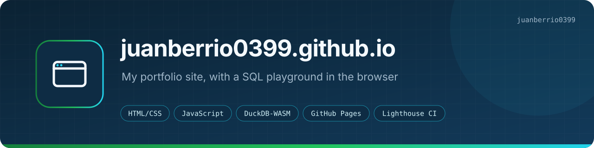
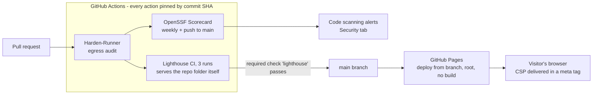
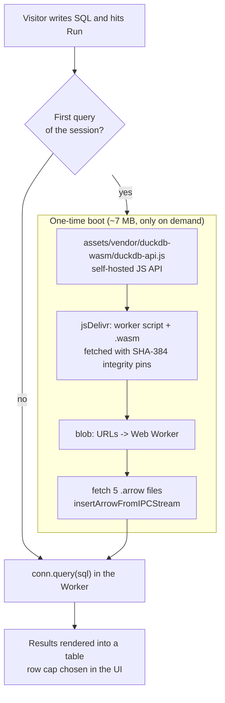

<p align="center"></p>
<p align="center"><b>English</b> · <a href="README.es.md">Español</a></p>
<p><b>What it does:</b> it's the source of <a href="https://juanberrio0399.github.io">juanberrio0399.github.io</a>, my portfolio as a Cloud &amp; Data Engineer: profile, projects, CV in EN/ES, the DataForge case study and a SQL playground.</p>
<p><b>How it works:</b> plain HTML, CSS and JavaScript, no build step. GitHub Pages serves <code>main</code> as is, and the playground runs DuckDB-WASM in your browser over a small snapshot of my public GitHub activity.</p>
<p><a href="https://github.com/juanberrio0399/juanberrio0399.github.io/actions/workflows/lighthouse.yml"></a> <a href="https://scorecard.dev/viewer/?uri=github.com/juanberrio0399/juanberrio0399.github.io"></a> <a href="LICENSE"></a></p>

---

## Why it exists

Most of my work runs on private company data, so a recruiter can't just open the repos. The site has two jobs. First, answer a recruiter in one page: EN/ES toggle, project tabs, a downloadable CV, and a print stylesheet so "Download Portfolio (PDF)" is just `window.print()`, with no PDF to keep in sync. Second, show the work instead of describing it: [`playground.html`](playground.html) runs real SQL in the visitor's browser with the same local-first pattern I use in the DataForge dashboards, small enough to read in one sitting.

## How it works

### Site and delivery



Pages deploys from the branch (`main`, `/`), so merging is deploying. `.nojekyll` switches Jekyll off; otherwise it would skip any path starting with an underscore and add a build step for nothing.

Pages can't send response headers, so the Content-Security-Policy goes in a `<meta http-equiv>` tag on every page. The base policy is `default-src 'none'` plus the few hosts the site actually uses (Google Fonts). `playground.html` has a wider policy of its own because WebAssembly needs it.

### Playground



The engine doesn't load with the page. The 7 MB download happens on the first `Run`, so someone who never runs a query only pays for a normal HTML page. The worker and the `.wasm` come from jsDelivr, but they're fetched with `fetch(..., { integrity })` against SHA-384 hashes pinned in [`assets/js/playground.js`](assets/js/playground.js) and started from `blob:` URLs. If the CDN ever serves a different file, it fails to load instead of running. Known DuckDB extensions are turned off (`autoinstall_known_extensions = false`), so a query can't pull code from a third host.

The data is five Apache Arrow IPC files, about 28 KB in total: 7 repos, 12 language rows, 77 commit-days, 154 pull requests and 1 snapshot row taken on 2026-09-15. I used Arrow instead of Parquet because DuckDB-WASM reads Arrow natively; Parquet would make the browser download the parquet extension at runtime.

The diagrams of the projects the site talks about (DataForge and the Serverless RAG Assistant) are in [docs/project-architecture.md](docs/project-architecture.md).

## What it connects to

| Repo or system | How |
|---|---|
| [juanberrio0399](https://github.com/juanberrio0399/juanberrio0399) | My GitHub profile README links here as the main portfolio |
| [serverless-rag-assistant](https://github.com/juanberrio0399/serverless-rag-assistant) | Project card with a link to the repo and the live demo |
| [dockerized-data-tool](https://github.com/juanberrio0399/dockerized-data-tool) | Project card with a link to the repo |
| [video-forge](https://github.com/juanberrio0399/video-forge) | Project card with a link to the repo |
| Signal Halo Studio, UGPP Shield Pro, CAOS CITY and the operations tools (private) | Project cards with no link; they only describe what each one does |
| DataForge and DataForge Cloud (private) | Described in `case-study-dataforge.html`, anonymized. That page is now the source; it used to live in a private repo |
| GitHub REST API | `scripts/playground/build_data.py` reads my public activity to rebuild the playground snapshot. The site never calls it at runtime |

## Running it locally

Any static file server works. The pages use relative paths (except `404.html`, on purpose).

```sh
python -m http.server 8000
# http://localhost:8000/  ·  /playground.html  ·  /case-study-dataforge.html
```

Opening the files with `file://` doesn't work: `playground.js` is an ES module and the Arrow fetches are same-origin.

Refresh the playground snapshot (writes to `assets/data/playground/`):

```sh
pip install duckdb pyarrow
GITHUB_TOKEN=$(gh auth token) python scripts/playground/build_data.py
```

The token is optional; it only raises the GitHub API rate limit. A run takes a few minutes and prints a row count per table.

Re-vendor the DuckDB-WASM API after bumping the engine version (needs `npm` and `openssl`):

```sh
sh scripts/playground/vendor_duckdb.sh
```

It rewrites `assets/vendor/duckdb-wasm/duckdb-api.js` and prints the four SHA-384 lines to paste into the `SRI` map in `assets/js/playground.js`. `ENGINE_VERSION` there and the versions in `THIRD_PARTY_NOTICES.txt` have to change in the same commit.

There's no local command for the quality gate. `npx @lhci/cli autorun` does run the audits on Windows, but chrome-launcher then fails to delete its temp folder (`EPERM`) and exits non-zero anyway, so the numbers that count are the ones from the Lighthouse job on the pull request. Its log links the full HTML report.

## Structure

| Path | What's there |
|---|---|
| `index.html` | The portfolio: profile, skills, project tabs, contact. JSON-LD and the per-page CSP |
| `case-study-dataforge.html` | DataForge case study and technical overview, EN/ES, with `assets/css/case-study.css` and `assets/js/case-study.js` |
| `playground.html` | The SQL playground: presets, editor, table schemas and its own wider CSP |
| `404.html` | Served by Pages for any unknown path; uses root-absolute asset paths for that reason |
| `assets/js/main.js` | Language toggle, project tabs, scroll reveal, print. No inline handlers, so the CSP needs no `'unsafe-inline'` |
| `assets/js/playground.js` | Engine boot, SRI pins, preset queries, EN/ES messages, result rendering |
| `assets/css/` | `main.css` (site + print), `case-study.css`, `playground.css`, `404.css` |
| `assets/cv/` | The downloadable CVs, EN and ES (PDF) |
| `assets/vendor/duckdb-wasm/` | Self-hosted DuckDB-WASM JS API (~215 KB, built by the vendor script) and its third-party notices |
| `assets/data/playground/*.arrow` | The committed snapshot the playground queries |
| `scripts/playground/` | `build_data.py` (rebuilds the Arrow files) and `vendor_duckdb.sh` (rebuilds the JS API and prints the hashes) |
| `docs/` | Project architecture diagrams, decisions and operation notes, product doc (user stories, flows, data), banners |
| `.github/workflows/` | `lighthouse.yml` (quality gate on every PR) and `scorecard.yml` (supply-chain score) |
| `.github/dependabot.yml` | Weekly grouped bump of the pinned action SHAs |
| `.lighthouserc.json` | Which pages Lighthouse audits (index, playground, case study) and the thresholds |
| `SECURITY.md` | Scope and how to report a vulnerability |
| `robots.txt`, `sitemap.xml`, `og-image.png`, `favicon.svg`, `.nojekyll` | Indexing, social preview and the Jekyll opt-out |

Why there's no framework, why the CSP is in a meta tag, what runs on its own and what to do when Lighthouse goes red: [docs/operation.md](docs/operation.md).

## Status

Live at <https://juanberrio0399.github.io>. All four pages, the playground end to end, both CI workflows, Dependabot and the security policy work. The playground snapshot is still refreshed by hand (issue [#42](https://github.com/juanberrio0399/juanberrio0399.github.io/issues/42)). Where it stands and what's next: [PLAN.md](PLAN.md). User stories, flows and data: [docs/PRODUCT.md](docs/PRODUCT.md).

## License

[MIT](LICENSE) · Juan Berrio
