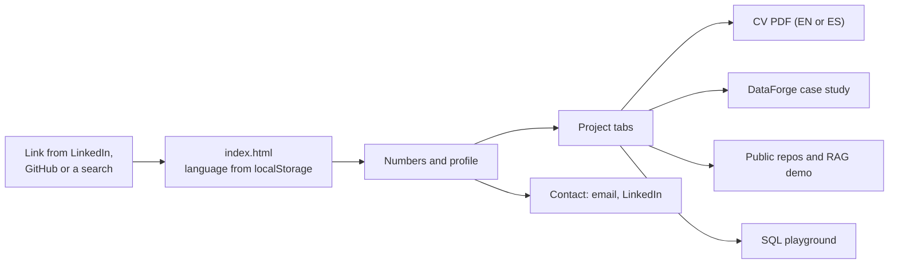
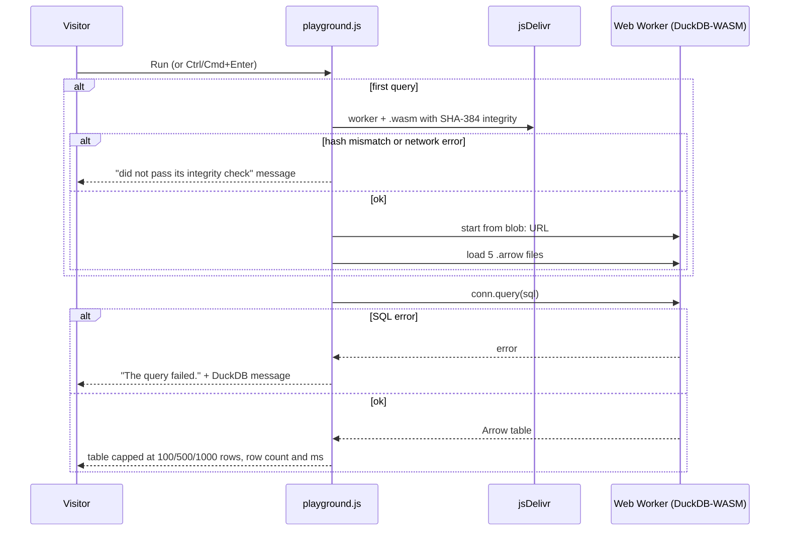
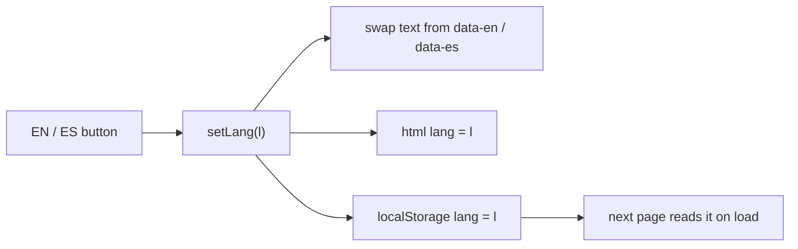
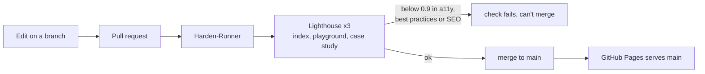
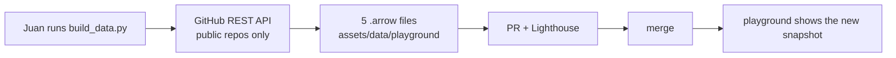
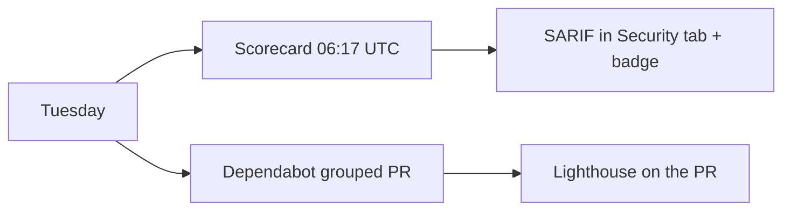

<a href="PRODUCTO.md">Español</a> · <b>English</b>

# The portfolio site as a product

User stories, flows and data for <https://juanberrio0399.github.io>. How it's built is in the [README](../README.md); decisions and the runbook are in [operation.md](operation.md).

## Who it's for

| Level | Who | What they need |
|---|---|---|
| External | A recruiter | Understand in one page who I am, what I've built and how to reach me, in English or Spanish, and take my CV with them |
| Management | A hiring manager or team lead | See impact in numbers and decide whether a call is worth it |
| Technical (external) | An engineer who interviews me | Check that the work is real: read the case study, run SQL in the browser, open the public repos |
| External services | Search engines and social networks | Index the pages and show a decent preview when someone shares the link |
| Day to day | Me, Juan | Change the content, refresh the playground data and publish by merging |
| Supervision | Also me | Keep quality and security from slipping without checking by hand |

## User stories

### Recruiter (external)

#### HU-01 · Read the profile in my language
**As** a recruiter **I want** to switch between English and Spanish **so that** I read the profile in the language I'm hiring in.
**Acceptance criteria**
- Given the `EN` / `ES` buttons, when I click one, then every element with `data-en` / `data-es` changes text and `<html lang>` changes too.
- The choice is saved in `localStorage` under `lang` and applies to the portfolio, the playground and the case study; if storage is blocked, the page still works in English.
**Where it lives:** `assets/js/main.js` (`setLang`), `assets/js/case-study.js`, `assets/js/playground.js`

#### HU-02 · Take the CV with me
**As** a recruiter **I want** to download the CV **so that** I can attach it to my process.
**Acceptance criteria**
- The "CV (EN)" and "CV (ES)" links open `assets/cv/CV_Juan_Berrio_EN.pdf` and `assets/cv/CV_Juan_Berrio_ES.pdf`, served from the site itself (no private repo involved).
- "Download Portfolio (PDF)" calls `window.print()` and the print stylesheet lays the page out for paper.
**Where it lives:** `index.html`, `assets/cv/`, `assets/js/main.js`, `assets/css/main.css`

#### HU-03 · Reach Juan
**As** a recruiter **I want** contact details in plain sight **so that** I don't have to hunt for them.
**Acceptance criteria**
- The header and the Contact section show email (`mailto:`), LinkedIn, GitHub and location/time zone (Bogotá, remote, GMT-5).
- On a phone, the menu opens with the ☰ button and closes after choosing a section.
**Where it lives:** `index.html`, `assets/js/main.js`

### Hiring manager (management)

#### HU-04 · See impact at a glance
**As** a hiring manager **I want** the key numbers first **so that** I can decide quickly whether to keep reading.
**Acceptance criteria**
- The top of the page shows 6+ years, 36M+ records processed, 13K+ Excel files automated, ~$0 infra cost and the number of projects.
- Each project tab ends with an "Impact" line in the selected language.
**Where it lives:** `index.html`

#### HU-05 · Compare projects without scrolling forever
**As** a hiring manager **I want** projects as tabs **so that** I jump to the one that matters to my role.
**Acceptance criteria**
- The Projects section has one tab per project (DataForge Cloud, DataForge, portal automation, UGPP Shield Pro, Hearthwood, RAG assistant, Docker tool); clicking a tab shows only that panel.
- Each panel says what the project does, how it's automated, the stack and, when it exists, a link to the repo, the demo or the case study.
**Where it lives:** `index.html`, `assets/js/main.js` (`showTab`)

### Technical interviewer (technical, external)

#### HU-06 · Read how DataForge is built
**As** an interviewer **I want** the case study and technical overview **so that** I can ask about real decisions.
**Acceptance criteria**
- `case-study-dataforge.html` has the case study and the technical overview in English and Spanish, with no client names.
- Opening it with `#caso` starts it in Spanish.
**Where it lives:** `case-study-dataforge.html`, `assets/js/case-study.js`

#### HU-07 · Run SQL in the browser
**As** an interviewer **I want** to query real data myself **so that** I see the local-first pattern working instead of reading about it.
**Acceptance criteria**
- Six preset queries (repositories, language mix, commits per week, PR lead time, busiest weekdays, table schema) load into the editor with one click.
- `Run` or Ctrl/Cmd+Enter executes the query; the status line shows rows and milliseconds, for example "Showing 100 of 154 rows · 12 ms", or "The query ran and returned no rows".
- The row cap can be 100, 500 or 1000; an empty editor gives "Write a query first."
- The status line shows when the data was taken ("Data snapshot: … UTC · GitHub REST API").
**Where it lives:** `playground.html`, `assets/js/playground.js`

#### HU-08 · Trust what runs in my browser
**As** an interviewer **I want** the engine to be verified **so that** a compromised CDN can't run code on my machine.
**Acceptance criteria**
- The engine (~7 MB) downloads only on the first query, with SHA-384 integrity checks; if a hash doesn't match, the page says "The engine could not be downloaded or did not pass its integrity check. Check your connection and try again."
- Without WebAssembly, it says "This browser does not support WebAssembly, which the playground needs."
- Extension autoinstall is off and every page carries a CSP; nothing the visitor types leaves the browser.
**Where it lives:** `assets/js/playground.js` (`SRI`, `boot`), CSP `<meta>` in each page

### Search engines and social networks (external services)

#### HU-09 · Index the site and preview it well
**As** a search engine or social network **I want** clear metadata **so that** the site is found and shared properly.
**Acceptance criteria**
- `sitemap.xml` lists the home page, the playground and the case study; `robots.txt` allows everything and points to the sitemap.
- `index.html` has Open Graph tags with `og-image.png` and JSON-LD `ProfilePage` with name, role, location and links.
- Unknown paths get `404.html`.
**Where it lives:** `sitemap.xml`, `robots.txt`, `index.html`, `404.html`

### Juan (day to day)

#### HU-10 · Publish a change by merging
**As** the owner **I want** a merge to be the deploy **so that** there's no build to break.
**Acceptance criteria**
- GitHub Pages serves `main` from the root; there's no build step and `.nojekyll` turns Jekyll off.
- A PR can't be merged until the `lighthouse` check passes and the branch is up to date.
**Where it lives:** repo settings, `.nojekyll`, `.github/workflows/lighthouse.yml`

#### HU-11 · Refresh the playground data
**As** the owner **I want** one command to rebuild the snapshot **so that** the playground shows recent activity.
**Acceptance criteria**
- `python scripts/playground/build_data.py` reads the public GitHub REST API (token optional) and writes five `.arrow` files to `assets/data/playground/`, printing the row count per table.
- The `snapshot` table records when the data was taken.
**Where it lives:** `scripts/playground/build_data.py`

#### HU-12 · Bump the SQL engine safely
**As** the owner **I want** a script that rebuilds the engine API and prints the hashes **so that** an upgrade doesn't break the integrity pins.
**Acceptance criteria**
- `sh scripts/playground/vendor_duckdb.sh` rewrites `assets/vendor/duckdb-wasm/duckdb-api.js` and prints the four SHA-384 lines for the `SRI` map.
**Where it lives:** `scripts/playground/vendor_duckdb.sh`

### Juan (supervision)

#### HU-13 · Keep quality from slipping
**As** the owner **I want** every PR audited **so that** a change can't quietly hurt accessibility or SEO.
**Acceptance criteria**
- Lighthouse runs 3 times on the home page, the playground and the case study; accessibility, best practices and SEO below 0.9 fail the check, performance below 0.9 only warns.
- The job uploads the HTML report and links it in the log.
**Where it lives:** `.github/workflows/lighthouse.yml`, `.lighthouserc.json`

#### HU-14 · Keep the supply chain clean
**As** the owner **I want** weekly security checks **so that** pinned actions and permissions don't go stale.
**Acceptance criteria**
- OpenSSF Scorecard runs Tuesdays 06:17 UTC, on pushes to `main` and on PRs touching `.github/**`, and publishes SARIF to the Security tab and the README badge.
- Dependabot opens one grouped PR every Tuesday to move the pinned action SHAs.
- Every action is pinned by commit SHA and Harden-Runner audits the job's network egress.
**Where it lives:** `.github/workflows/scorecard.yml`, `.github/dependabot.yml`

## Flows

### A recruiter's visit

Everything is static, so the only things that can fail are the network or a missing file; a broken link lands on `404.html`, which has a way back home.

### Running a query in the playground

If the boot fails, the next `Run` tries again from scratch instead of staying broken.

### Switching language

If `localStorage` is blocked (private mode, strict settings), the toggle still works on the current page and the next page starts in English.

### Publishing a change

A red Lighthouse check blocks the merge; the job log links the full report with the failing audit.

### Refreshing the playground data

Without a token the API can rate-limit the run; setting `GITHUB_TOKEN` raises the limit. Today this is manual.

### Weekly supply-chain checks

A Scorecard drop points to the file and line in the Security tab.

## Information

| Data | Comes from | Stored in | Read by | Sensitivity | Retention |
|---|---|---|---|---|---|
| Profile text, projects, numbers | Me | `index.html`, `case-study-dataforge.html` | Any visitor | Public | Until I change it |
| CV PDFs | Exported from my private CV repo | `assets/cv/` | Any visitor | Public (includes my email and phone on purpose) | Until replaced |
| Contact details (email, phone, LinkedIn) | Me | `index.html` and JSON-LD | Visitors, search engines | Public by choice | Until I change it |
| Playground snapshot (repos, languages, commits per day, PRs) | GitHub REST API, public repos only | `assets/data/playground/*.arrow` | The visitor's browser | Public | Until the next refresh |
| Language preference | The visitor's click | The visitor's `localStorage` (`lang`) | The site's scripts | Not personal | Until the visitor clears it |
| SQL the visitor writes | The visitor | The browser's memory | DuckDB-WASM in that tab | Stays local | Gone when the tab closes |
| Lighthouse reports | CI | Temporary public storage + Actions artifacts | Me | Public | A few days |
| `GITHUB_TOKEN` (optional, local) | `gh auth token` | My shell only | `build_data.py` | Secret | Not stored |

No cookies, no analytics, no forms, no backend.

## Connections

| System | What for | How | If it goes down |
|---|---|---|---|
| GitHub Pages | Hosts the site | Deploy from branch `main` | The site is down |
| jsDelivr | Playground engine (worker + `.wasm`) | HTTPS with SHA-384 pins | The playground can't start; the rest of the site works |
| Google Fonts | Typography | CSS and font files allowed in the CSP | The browser falls back to system fonts |
| GitHub REST API | Snapshot for the playground | `build_data.py`, run by hand | Nothing live breaks; the snapshot just ages |
| GitHub Actions | Lighthouse, Scorecard | `lighthouse.yml`, `scorecard.yml` | PRs can't be merged (required check) |
| [juanberrio0399](https://github.com/juanberrio0399/juanberrio0399) | Profile README that links here | Link | Nothing changes here |
| [serverless-rag-assistant](https://github.com/juanberrio0399/serverless-rag-assistant), [dockerized-data-tool](https://github.com/juanberrio0399/dockerized-data-tool) | Project cards link the repos and the RAG demo | Links | The card stays; the link fails |
| My private CV repo | Source of the CV PDFs | Manual copy into `assets/cv/` | The site keeps the last copy |
| LinkedIn, email | Contact | Links | Out of the site's hands |

## Pending

- Refresh the playground snapshot on a schedule ([#42](https://github.com/juanberrio0399/juanberrio0399.github.io/issues/42)).
- A better SQL editor and charts for results ([#43](https://github.com/juanberrio0399/juanberrio0399.github.io/issues/43), [#41](https://github.com/juanberrio0399/juanberrio0399.github.io/issues/41), [#49](https://github.com/juanberrio0399/juanberrio0399.github.io/issues/49)).
- Speculation Rules and cross-document view transitions ([#34](https://github.com/juanberrio0399/juanberrio0399.github.io/issues/34), [#50](https://github.com/juanberrio0399/juanberrio0399.github.io/issues/50)).
- Content fixes for the next phase: the profile still says the DataForge dashboard "updates itself three times a day" (today runs are manual), the case study still mentions Task Scheduler 3x/day, and the Hearthwood card says ~23 services (the code has 48 server services now).
- DNS and Pages settings as code (Terraform).
