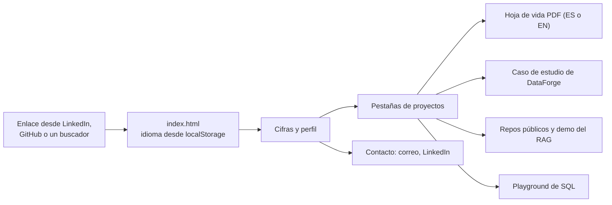
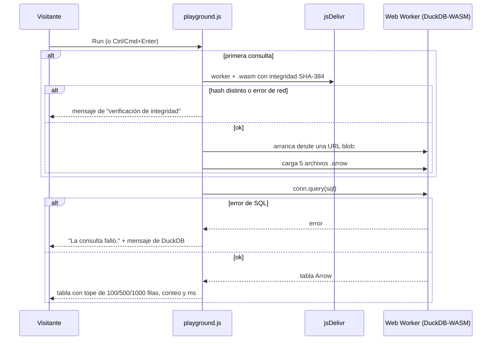
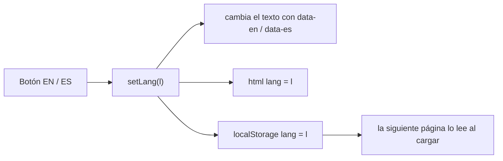
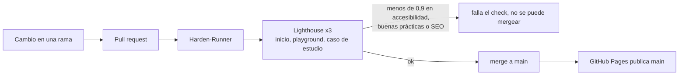
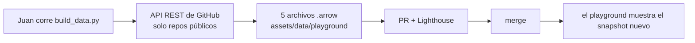
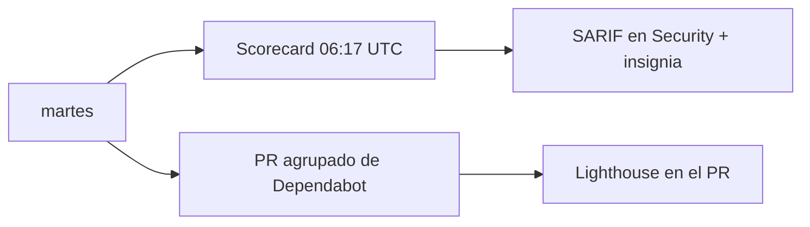

<b>Español</b> · <a href="PRODUCT.md">English</a>

# El sitio de portafolio como producto

Historias de usuario, flujos y datos de <https://juanberrio0399.github.io>. Cómo está hecho está en el [README](../README.es.md); las decisiones y la guía de operación, en [operation.es.md](operation.es.md).

## Para quién es

| Nivel | Quién | Qué necesita |
|---|---|---|
| Externo | Un reclutador | Entender en una página quién soy, qué he construido y cómo contactarme, en inglés o español, y llevarse mi hoja de vida |
| Gerencia | Un líder de equipo o quien toma la decisión de contratar | Ver el impacto en números y decidir si vale la pena una llamada |
| Técnico (externo) | Un ingeniero que me entrevista | Comprobar que el trabajo es real: leer el caso de estudio, correr SQL en el navegador, abrir los repos públicos |
| Servicios externos | Buscadores y redes sociales | Indexar las páginas y mostrar una buena vista previa cuando alguien comparte el enlace |
| Día a día | Yo, Juan | Cambiar el contenido, actualizar los datos del playground y publicar al mergear |
| Supervisión | También yo | Que la calidad y la seguridad no se degraden sin tener que revisar a mano |

## Historias de usuario

### Reclutador (externo)

#### HU-01 · Leer el perfil en mi idioma
**Como** reclutador **quiero** cambiar entre inglés y español **para** leer el perfil en el idioma en que estoy contratando.
**Criterios de aceptación**
- Dados los botones `EN` / `ES`, cuando hago clic en uno, cambia el texto de todo elemento con `data-en` / `data-es` y también cambia `<html lang>`.
- La elección se guarda en `localStorage` con la llave `lang` y aplica al portafolio, al playground y al caso de estudio; si el almacenamiento está bloqueado, la página sigue funcionando en inglés.
**Dónde vive:** `assets/js/main.js` (`setLang`), `assets/js/case-study.js`, `assets/js/playground.js`

#### HU-02 · Llevarme la hoja de vida
**Como** reclutador **quiero** descargar la hoja de vida **para** adjuntarla a mi proceso.
**Criterios de aceptación**
- Los enlaces "CV (EN)" y "CV (ES)" abren `assets/cv/CV_Juan_Berrio_EN.pdf` y `assets/cv/CV_Juan_Berrio_ES.pdf`, servidos desde el propio sitio (sin pasar por un repo privado).
- "Descargar portafolio (PDF)" llama a `window.print()` y la hoja de estilos de impresión acomoda la página para papel.
**Dónde vive:** `index.html`, `assets/cv/`, `assets/js/main.js`, `assets/css/main.css`

#### HU-03 · Contactar a Juan
**Como** reclutador **quiero** los datos de contacto a la vista **para** no tener que buscarlos.
**Criterios de aceptación**
- El encabezado y la sección de contacto muestran correo (`mailto:`), LinkedIn, GitHub y ubicación/zona horaria (Bogotá, remoto, GMT-5).
- En el celular, el menú se abre con el botón ☰ y se cierra al elegir una sección.
**Dónde vive:** `index.html`, `assets/js/main.js`

### Quien decide la contratación (gerencia)

#### HU-04 · Ver el impacto de un vistazo
**Como** líder que contrata **quiero** las cifras clave primero **para** decidir rápido si sigo leyendo.
**Criterios de aceptación**
- Arriba de la página aparecen 6+ años, 36M+ registros procesados, 13K+ archivos Excel automatizados, ~$0 de infraestructura y el número de proyectos de las pestañas (9).
- Cada pestaña de proyecto termina con una línea de "Impacto" en el idioma elegido.
**Dónde vive:** `index.html`

#### HU-05 · Comparar proyectos sin scroll infinito
**Como** líder que contrata **quiero** los proyectos en pestañas **para** ir directo al que le sirve a mi cargo.
**Criterios de aceptación**
- La sección de proyectos tiene una pestaña por proyecto (DataForge Cloud, DataForge, automatización operativa, Video Forge, Signal Halo Studio, asistente RAG, herramienta Docker, UGPP Shield Pro, CAOS CITY), nueve en total; al hacer clic solo se ve ese panel.
- Cada panel dice qué hace el proyecto, cómo se automatiza, el stack y, cuando existe, el enlace al repo, a la demo o al caso de estudio.
**Dónde vive:** `index.html`, `assets/js/main.js` (`showTab`)

### Entrevistador técnico (técnico, externo)

#### HU-06 · Leer cómo está hecho DataForge
**Como** entrevistador **quiero** el caso de estudio y el detalle técnico **para** preguntar por decisiones reales.
**Criterios de aceptación**
- `case-study-dataforge.html` trae el caso de estudio y el detalle técnico en inglés y español, sin nombres de clientes.
- Si se abre con `#caso`, arranca en español.
**Dónde vive:** `case-study-dataforge.html`, `assets/js/case-study.js`

#### HU-07 · Correr SQL en el navegador
**Como** entrevistador **quiero** consultar datos reales yo mismo **para** ver el patrón local-first funcionando en vez de leer sobre él.
**Criterios de aceptación**
- Seis consultas de ejemplo (repositorios, mezcla de lenguajes, commits por semana, tiempo de merge de PRs, días más activos, esquema de tablas) se cargan en el editor con un clic.
- `Run` o Ctrl/Cmd+Enter ejecuta la consulta; la línea de estado muestra filas y milisegundos, por ejemplo "Mostrando 100 de 154 filas · 12 ms", o "La consulta corrió y no devolvió filas".
- El tope de filas puede ser 100, 500 o 1000; con el editor vacío sale "Primero escribe una consulta.".
- La línea de estado dice cuándo se tomaron los datos ("Foto de los datos: … UTC · API REST de GitHub").
**Dónde vive:** `playground.html`, `assets/js/playground.js`

#### HU-08 · Confiar en lo que corre en mi navegador
**Como** entrevistador **quiero** que el motor esté verificado **para** que un CDN comprometido no pueda ejecutar código en mi equipo.
**Criterios de aceptación**
- El motor (~7 MB) se descarga solo con la primera consulta y con verificación SHA-384; si un hash no coincide, la página dice "No se pudo descargar el motor o no pasó la verificación de integridad. Revisa tu conexión e inténtalo de nuevo.".
- Sin WebAssembly, dice "Este navegador no soporta WebAssembly, que el playground necesita.".
- La instalación automática de extensiones está apagada y cada página lleva su CSP; nada de lo que escribe el visitante sale del navegador.
**Dónde vive:** `assets/js/playground.js` (`SRI`, `boot`), la CSP en el `<meta>` de cada página

### Buscadores y redes sociales (servicios externos)

#### HU-09 · Indexar el sitio y mostrar una buena vista previa
**Como** buscador o red social **quiero** metadatos claros **para** que el sitio se encuentre y se comparta bien.
**Criterios de aceptación**
- `sitemap.xml` lista la página principal, el playground y el caso de estudio; `robots.txt` permite todo y apunta al sitemap.
- `index.html` tiene etiquetas Open Graph con `og-image.png` y JSON-LD `ProfilePage` con nombre, cargo, ubicación y enlaces.
- Las rutas desconocidas reciben `404.html`.
**Dónde vive:** `sitemap.xml`, `robots.txt`, `index.html`, `404.html`

### Juan (día a día)

#### HU-10 · Publicar un cambio al mergear
**Como** dueño **quiero** que mergear sea desplegar **para** que no haya un build que se pueda dañar.
**Criterios de aceptación**
- GitHub Pages publica `main` desde la raíz; no hay paso de build y `.nojekyll` apaga Jekyll.
- Un PR no se puede mergear hasta que pase el check `lighthouse` y la rama esté al día.
**Dónde vive:** configuración del repo, `.nojekyll`, `.github/workflows/lighthouse.yml`

#### HU-11 · Actualizar los datos del playground
**Como** dueño **quiero** un solo comando que reconstruya el snapshot **para** que el playground muestre actividad reciente.
**Criterios de aceptación**
- `python scripts/playground/build_data.py` lee la API REST pública de GitHub (el token es opcional) y escribe cinco archivos `.arrow` en `assets/data/playground/`, imprimiendo cuántas filas quedó cada tabla.
- La tabla `snapshot` guarda cuándo se tomaron los datos.
**Dónde vive:** `scripts/playground/build_data.py`

#### HU-12 · Subir de versión el motor SQL sin romper nada
**Como** dueño **quiero** un script que reconstruya la API del motor e imprima los hashes **para** que una actualización no rompa la verificación de integridad.
**Criterios de aceptación**
- `sh scripts/playground/vendor_duckdb.sh` reescribe `assets/vendor/duckdb-wasm/duckdb-api.js` e imprime las cuatro líneas SHA-384 del mapa `SRI`.
**Dónde vive:** `scripts/playground/vendor_duckdb.sh`

### Juan (supervisión)

#### HU-13 · Que la calidad no se degrade
**Como** dueño **quiero** que cada PR se audite **para** que un cambio no dañe en silencio la accesibilidad o el SEO.
**Criterios de aceptación**
- Lighthouse corre 3 veces sobre la página principal, el playground y el caso de estudio; accesibilidad, buenas prácticas y SEO por debajo de 0,9 tumban el check, y rendimiento por debajo de 0,9 solo avisa.
- El job sube el reporte HTML y lo enlaza en el log.
**Dónde vive:** `.github/workflows/lighthouse.yml`, `.lighthouserc.json`

#### HU-14 · Mantener limpia la cadena de suministro
**Como** dueño **quiero** revisiones de seguridad semanales **para** que las actions fijadas y los permisos no se queden viejos.
**Criterios de aceptación**
- OpenSSF Scorecard corre los martes a las 06:17 UTC, en cada push a `main` y en los PRs que tocan `.github/**`, y publica SARIF en la pestaña Security y la insignia del README.
- Dependabot abre un PR agrupado cada martes para mover los SHA fijados de las actions.
- Cada action está fijada por SHA de commit y Harden-Runner audita las salidas de red del job.
**Dónde vive:** `.github/workflows/scorecard.yml`, `.github/dependabot.yml`

## Flujos

### La visita de un reclutador

Todo es estático, así que lo único que puede fallar es la red o un archivo que falte; un enlace roto cae en `404.html`, que tiene cómo volver al inicio.

### Correr una consulta en el playground

Si el arranque falla, el siguiente `Run` lo vuelve a intentar desde cero en vez de quedarse dañado.

### Cambiar de idioma

Si `localStorage` está bloqueado (modo privado, configuración estricta), el cambio funciona en la página actual y la siguiente arranca en inglés.

### Publicar un cambio

Un Lighthouse en rojo bloquea el merge; el log del job enlaza el reporte completo con la auditoría que falló.

### Actualizar los datos del playground

Sin token, la API puede limitar la corrida; con `GITHUB_TOKEN` el límite sube. Hoy esto es manual.

### Revisiones semanales de la cadena de suministro

Si baja el Scorecard, la pestaña Security señala el archivo y la línea.

## Información

| Dato | De dónde viene | Dónde se guarda | Quién lo lee | Sensibilidad | Cuánto dura |
|---|---|---|---|---|---|
| Texto del perfil, proyectos, cifras | Yo | `index.html`, `case-study-dataforge.html` | Cualquier visitante | Pública | Hasta que lo cambie |
| Hojas de vida en PDF | Exportadas de mi repo privado de hojas de vida | `assets/cv/` | Cualquier visitante | Pública (incluye mi correo y teléfono a propósito) | Hasta que se reemplacen |
| Datos de contacto (correo, teléfono, LinkedIn) | Yo | `index.html` y el JSON-LD | Visitantes, buscadores | Pública por decisión propia | Hasta que los cambie |
| Snapshot del playground (repos, lenguajes, commits por día, PRs) | API REST de GitHub, solo repos públicos | `assets/data/playground/*.arrow` | El navegador del visitante | Pública | Hasta la siguiente actualización |
| Preferencia de idioma | El clic del visitante | `localStorage` del visitante (`lang`) | Los scripts del sitio | No es personal | Hasta que el visitante la borre |
| SQL que escribe el visitante | El visitante | La memoria del navegador | DuckDB-WASM en esa pestaña | Se queda local | Se pierde al cerrar la pestaña |
| Reportes de Lighthouse | El CI | Almacenamiento público temporal + artefactos de Actions | Yo | Pública | Unos días |
| `GITHUB_TOKEN` (opcional, local) | `gh auth token` | Solo mi terminal | `build_data.py` | Secreta | No se guarda |

Sin cookies, sin analítica, sin formularios, sin backend.

## Conexiones

| Sistema | Para qué | Cómo | Si se cae |
|---|---|---|---|
| GitHub Pages | Aloja el sitio | Deploy desde la rama `main` | El sitio no está disponible |
| jsDelivr | Motor del playground (worker + `.wasm`) | HTTPS con hashes SHA-384 fijados | El playground no arranca; el resto del sitio funciona |
| Google Fonts | Tipografía | CSS y fuentes permitidas en la CSP | El navegador usa fuentes del sistema |
| API REST de GitHub | Snapshot del playground | `build_data.py`, a mano | No se daña nada en vivo; el snapshot solo envejece |
| GitHub Actions | Lighthouse, Scorecard | `lighthouse.yml`, `scorecard.yml` | Los PR no se pueden mergear (check obligatorio) |
| [juanberrio0399](https://github.com/juanberrio0399/juanberrio0399) | README del perfil que enlaza aquí | Enlace | Aquí no cambia nada |
| [serverless-rag-assistant](https://github.com/juanberrio0399/serverless-rag-assistant), [dockerized-data-tool](https://github.com/juanberrio0399/dockerized-data-tool) | Las tarjetas de proyecto enlazan los repos y la demo del RAG | Enlaces | La tarjeta queda; el enlace falla |
| Mi repo privado de hojas de vida | Origen de los PDF | Copia manual a `assets/cv/` | El sitio conserva la última copia |
| LinkedIn, correo | Contacto | Enlaces | No depende del sitio |

## Pendiente

- Actualizar el snapshot del playground de forma programada ([#42](https://github.com/juanberrio0399/juanberrio0399.github.io/issues/42)).
- Un mejor editor de SQL y gráficas para los resultados ([#43](https://github.com/juanberrio0399/juanberrio0399.github.io/issues/43), [#41](https://github.com/juanberrio0399/juanberrio0399.github.io/issues/41), [#49](https://github.com/juanberrio0399/juanberrio0399.github.io/issues/49)).
- Speculation Rules y transiciones entre páginas ([#34](https://github.com/juanberrio0399/juanberrio0399.github.io/issues/34), [#50](https://github.com/juanberrio0399/juanberrio0399.github.io/issues/50)).
- Correcciones de contenido para la próxima fase: el perfil todavía dice que el tablero de DataForge "se actualiza solo tres veces al día" (hoy las corridas son manuales), el caso de estudio todavía menciona Task Scheduler 3x/día y la tarjeta de Hearthwood dice ~23 servicios (hoy el código tiene 48 servicios de servidor).
- DNS y configuración de Pages como código (Terraform).
